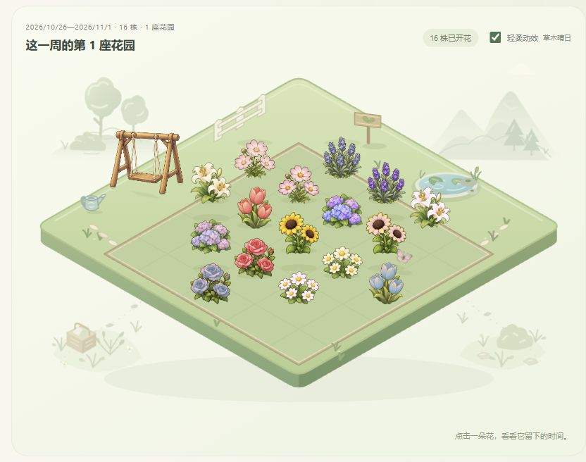
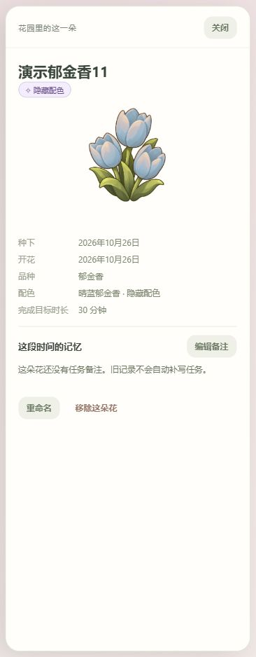
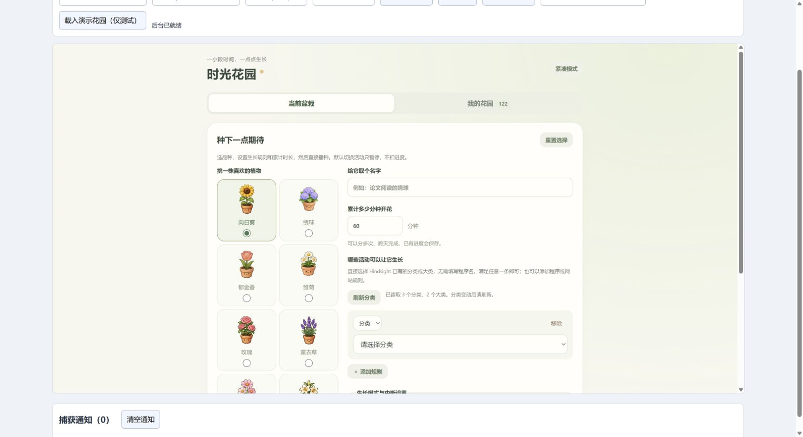
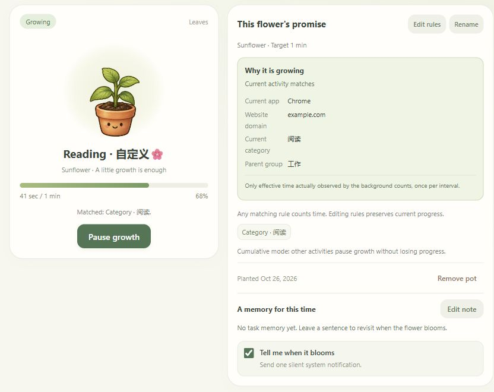
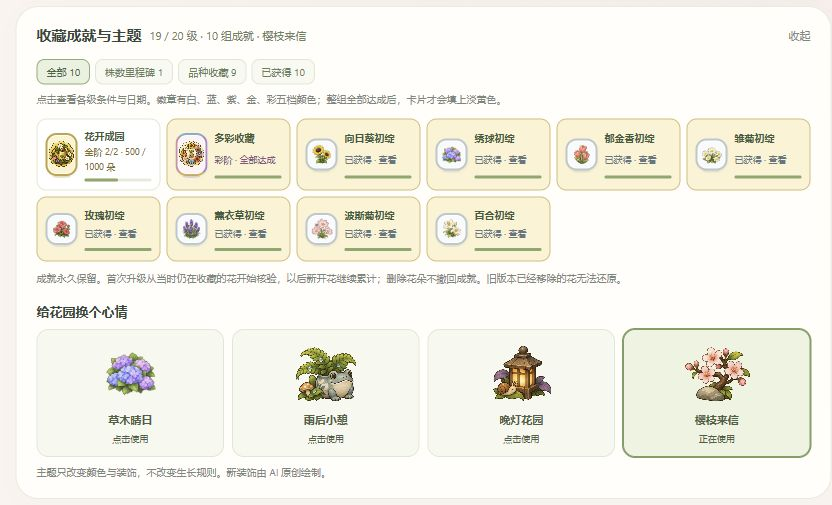
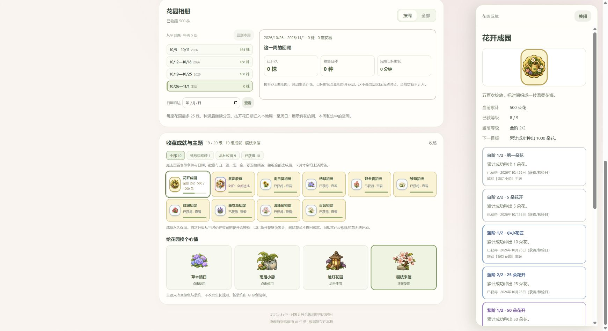
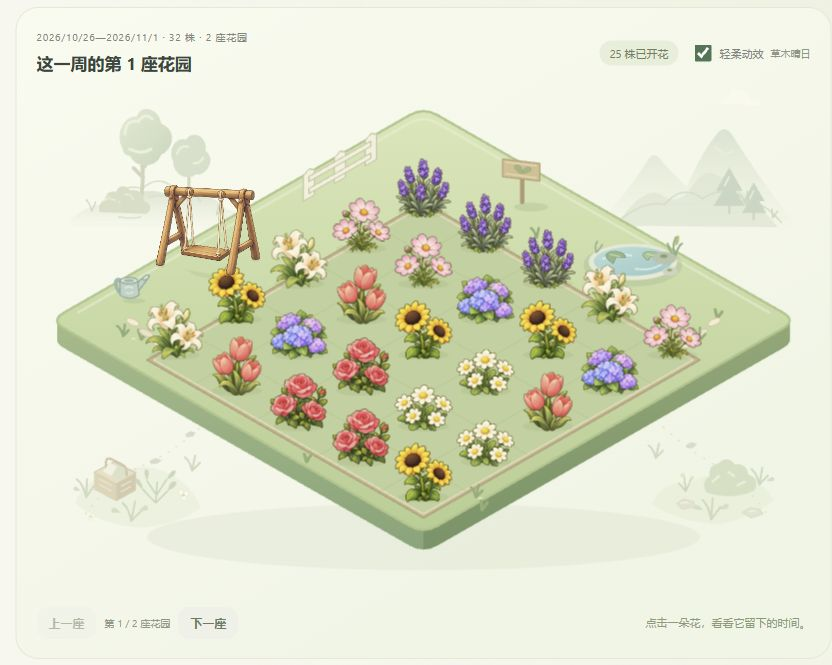
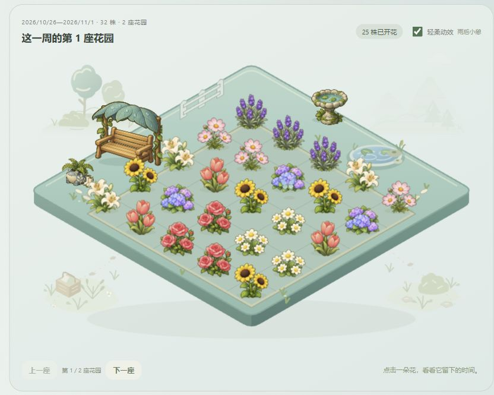
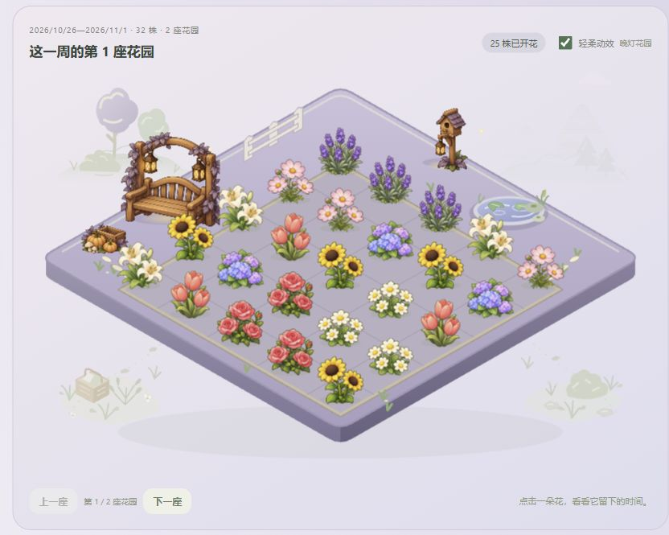
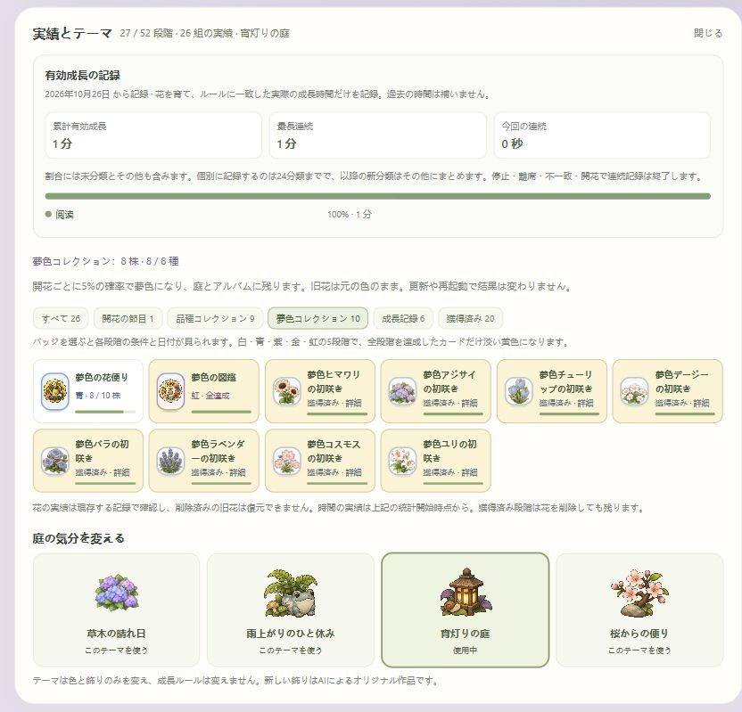

# Time Garden

[简体中文](README.md) · English

Let a little everyday time become a garden. A third-party [Hindsight](https://github.com/Tomotsugu-dev/Hindsight) plugin that grows flowers from matching foreground activity, using your existing categories.

**[Download 0.18.0](https://github.com/Yoshino2000/hindsight-garden/releases/tag/0.18.0)** · [Install and use](docs/usage.en.md) · [Verification](docs/verification.md)

Version 0.18.0 shrinks the package from 29 MB to 12 MB, writes less often while idle, and uses shorter, clearer interface text.

## A breeze through the flowers

All eight flowers and their hidden palettes sway together, with small ground shadows following along. Each gust lasts 4.5 seconds, followed by 3–10 seconds of rest. Motion is optional and album previews stay still. Version 0.17.0 also fixes slow-write timing and old-worker recovery, while reducing repeated work for large collections.

## A little surprise at bloom

Each of the eight flowers has one hidden palette, with an independent **5%** chance per bloom. Keep it in the garden and album permanently. Older blooms keep their original colors; there is no guaranteed drop.

This is a manually arranged palette demonstration, not a probability sample.

## Choose a flower, plant a little hope

Eight plants. Pick an existing Hindsight category; the recommendation button combines it, or a random task, with the selected flower's name. Save reusable plans and leave a task memory for each flower.

## A little progress, whenever you return

Cumulative mode is the default: switching away pauses growth. Progress sits beside the rules, task note and optional bloom notification. Interruption deductions are available if you choose them.

## Understand why growth pauses

The current pot explains the observed app, domain, category and matching rule, with distinct messages for manual pause, missing information, mismatches and deleted categories.

## A garden for every week

Completed flowers stay in weekly albums, splitting into another garden after 25 plants. Browse the chronological index five weeks per page, with navigation for older pages. Weekly reviews summarize blooms, species and completed goal time; old flowers are never automatically deleted to make room.

## Collect five colours of memories

Fifty-two permanent achievement levels fit into twenty-six cards, including sixteen new hidden-collection conditions. White, blue, purple, gold and rainbow badges keep each level's record. Open a card for conditions, progress and dates. Removing flowers does not revoke earned achievements.

## Change the garden's mood

Meadow keeps its gentle swing. Light rain falls continuously in the rain theme and makes small splashes on the lawn. Dusk is a little darker, with three warm lamps and occasional fireflies. Blossom petals settle and fade on the grass. All four themes have expanding pond ripples and drifting lily pads; motion is optional.

| Meadow | After the rain |
| :--: | :--: |
|  |  |
| **Lantern dusk** | **Blossom letter** |
|  |  |

## Your interface language, your own words

The interface follows the environment language: Simplified Chinese, English or Japanese, with English as the fallback. Flower names, task memories and Hindsight category names keep their original text.

## Get started

Download the ZIP and install it in Hindsight **Settings → Plugins**, then open **时光花园**. Requires Hindsight 0.10.0+; market installation requires 0.10.2+. Back up your data before updating. See the [detailed guide](docs/usage.en.md) for compatibility and rollback information.

**Development is ongoing. Basic functionality is usable, but testing is not exhaustive and problems or risks may remain.** See [verification](docs/verification.md) and the [0.17.0 audit](docs/audit-0170.md) for this round's checks and final test results. Screenshots use an isolated simulated host and demonstration data. Apart from this version's breeze capture, images retain actual Chrome examples from 0.16.0 and earlier; some older examples remain Chinese. The final ZIP has not been installed in native Hindsight. OS notification delivery and long-running GPU performance are unverified. The runtime makes no network requests and stores data locally. Removing plugin data during uninstall removes the garden too.

[Permissions and data](docs/usage.en.md#data-and-permissions) · [Development](docs/development.md) · [Artwork](docs/artwork.md) · [Verification](docs/verification.md) · [MIT](LICENSE)
