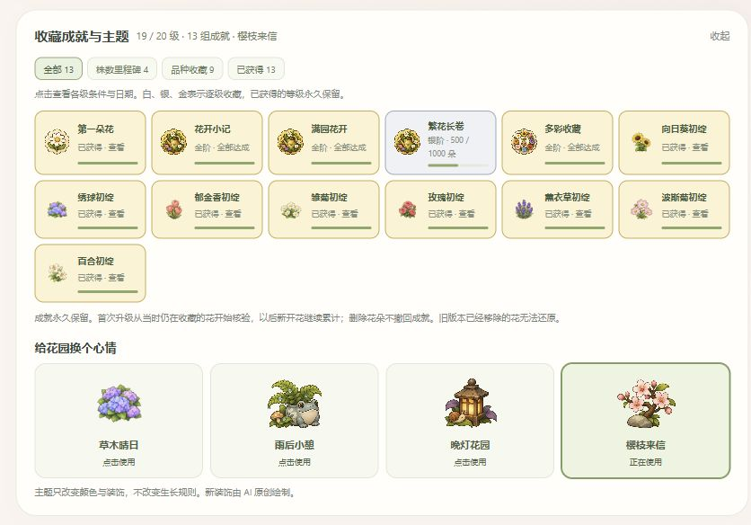
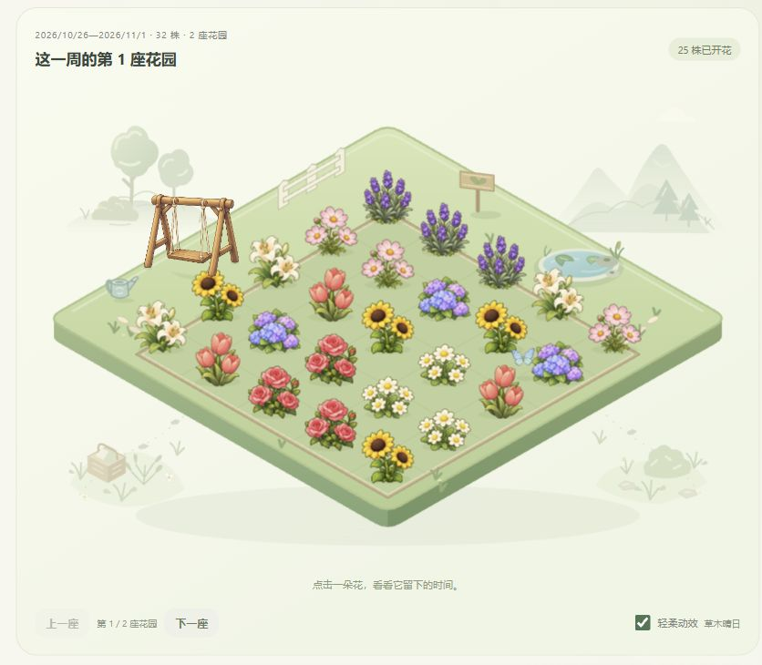
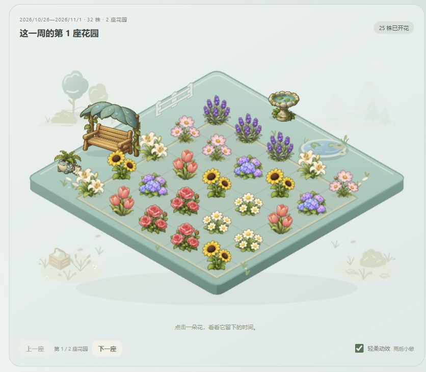
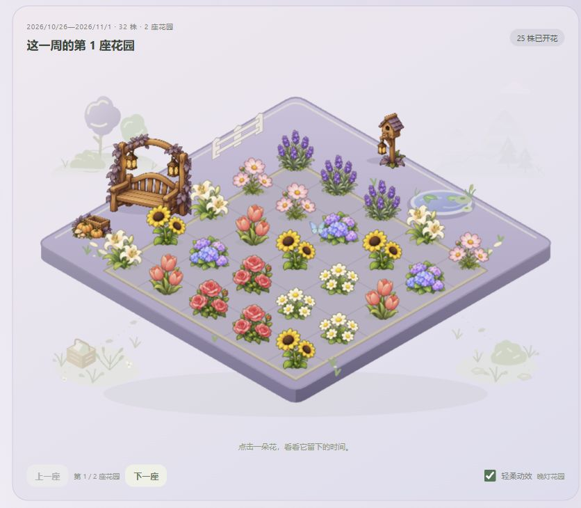

# Time Garden

[简体中文](README.md) · English

Let a little everyday time become a garden. A third-party [Hindsight](https://github.com/Tomotsugu-dev/Hindsight) plugin that grows flowers from matching foreground activity, using your existing categories.

**[Download 0.13.0](https://github.com/Yoshino2000/hindsight-garden/releases/tag/0.13.0)** · [Install and use](docs/usage.en.md) · [Verification](docs/verification.md)

## Choose a flower, plant a little hope

Eight plants. Pick an existing Hindsight category; the recommendation button combines it, or a random task, with the selected flower's name. Save reusable plans and leave a task memory for each flower.

## A little progress, whenever you return

Cumulative mode is the default: switching away pauses growth. Progress sits beside the rules, task note and optional bloom notification. Interruption deductions are available if you choose them.

## A garden for every week

Completed flowers stay in weekly albums, splitting into another garden after 25 plants. Use the compact chronological index to revisit them. Weekly reviews summarize blooms, species and completed goal time; old flowers are never automatically deleted to make room.

## Collect memories in white, silver and gold

Twenty achievement levels fit into thirteen cards. The 250 / 500 / 1,000-bloom milestones share a tiered card. Open it to see each condition, progress and earned date.

## Change the garden's mood

Meadow keeps its gently swaying swing. Rain, dusk and blossom have distinct palettes and furniture. Small birds, butterflies and pond ripples visit quietly; motion is optional.

| Meadow | After the rain |
| :--: | :--: |
|  |  |
| **Lantern dusk** | **Blossom letter** |
|  |  |

## Get started

Download the ZIP and install it in Hindsight **Settings → Plugins**, then open **时光花园**. Requires Hindsight 0.10.0+; market installation requires 0.10.2+. Back up your data before updating. See the [detailed guide](docs/usage.en.md) for compatibility and rollback information.

**Development is ongoing. Basic functionality is usable, but testing is not exhaustive and problems or risks may remain.** Screenshots show the actual plugin UI in connected Chrome with an isolated simulated host and demonstration data; they do not prove native Hindsight installation or Windows notification behavior. The runtime makes no network requests and stores data locally. Removing plugin data during uninstall removes the garden too. The UI shown in these screenshots is Chinese.

[Permissions and data](docs/usage.en.md#data-and-permissions) · [Development](docs/development.md) · [Artwork](docs/artwork.md) · [Verification](docs/verification.md) · [MIT](LICENSE)
