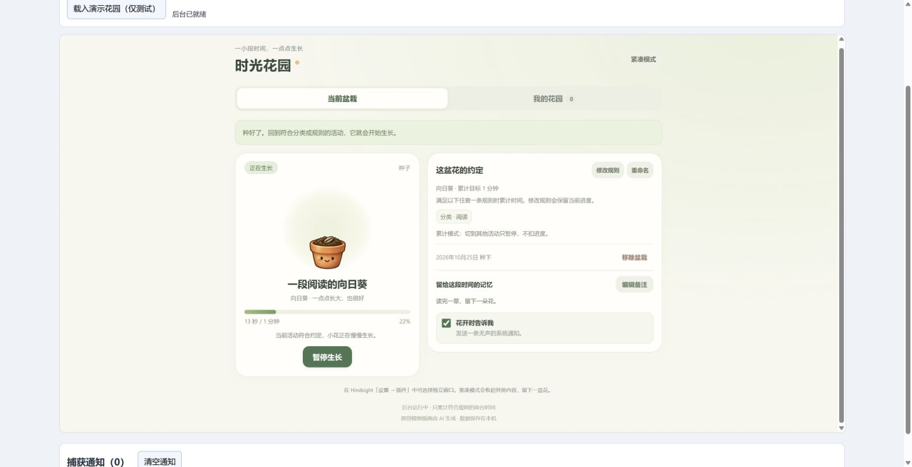

# Time Garden

[简体中文](README.md) · English

Let a little everyday time become a garden. A third-party [Hindsight](https://github.com/Tomotsugu-dev/Hindsight) plugin that grows flowers from matching foreground activity, using your existing categories.

**[Download 0.15.0](https://github.com/Yoshino2000/hindsight-garden/releases/tag/0.15.0)** · [Install and use](docs/usage.en.md) · [Verification](docs/verification.md)

## Choose a flower, plant a little hope

Eight plants. Pick an existing Hindsight category; the recommendation button combines it, or a random task, with the selected flower's name. Save reusable plans and leave a task memory for each flower.

## A little progress, whenever you return

Cumulative mode is the default: switching away pauses growth. Progress sits beside the rules, task note and optional bloom notification. Interruption deductions are available if you choose them.

## Understand why growth pauses

The current pot explains the observed app, domain, category and matching rule, with distinct messages for manual pause, missing information, mismatches and deleted categories.

## A garden for every week

Completed flowers stay in weekly albums, splitting into another garden after 25 plants. Browse the chronological index five weeks per page, with navigation for older pages. Weekly reviews summarize blooms, species and completed goal time; old flowers are never automatically deleted to make room.

## Collect five colours of memories

Thirty-six achievement levels fit into sixteen cards. All nine bloom milestones share one card with white, blue, purple, gold and rainbow badge colours. Cards stay white until every level is earned, then turn pale yellow. New levels cover uninterrupted stretches, total effective growth, category variety and category shares. Statistics begin at upgrade, without reconstructing old activity. Open one for its conditions, progress and dates.

## Change the garden's mood

Meadow keeps its gently swaying swing. Rain adds leaf-tip drops, dusk adds ground light and occasional fireflies, and blossom adds petals falling from the scene top and fading on the lawn, plus lantern light. Each has its own palette and furniture. All four themes have expanding pond ripples and subtly drifting lily pads. Small birds and butterflies visit quietly; motion is optional.

| Meadow | After the rain |
| :--: | :--: |
|  |  |
| **Lantern dusk** | **Blossom letter** |
|  |  |

## Get started

Download the ZIP and install it in Hindsight **Settings → Plugins**, then open **时光花园**. Requires Hindsight 0.10.0+; market installation requires 0.10.2+. Back up your data before updating. See the [detailed guide](docs/usage.en.md) for compatibility and rollback information.

**Development is ongoing. Basic functionality is usable, but testing is not exhaustive and problems or risks may remain.** Screenshots show the actual plugin UI in connected Chrome with an isolated simulated host and demonstration data; they do not prove native Hindsight installation or Windows notification behavior. The runtime makes no network requests and stores data locally. Removing plugin data during uninstall removes the garden too. The UI shown in these screenshots is Chinese.

[Permissions and data](docs/usage.en.md#data-and-permissions) · [Development](docs/development.md) · [Artwork](docs/artwork.md) · [Verification](docs/verification.md) · [MIT](LICENSE)
