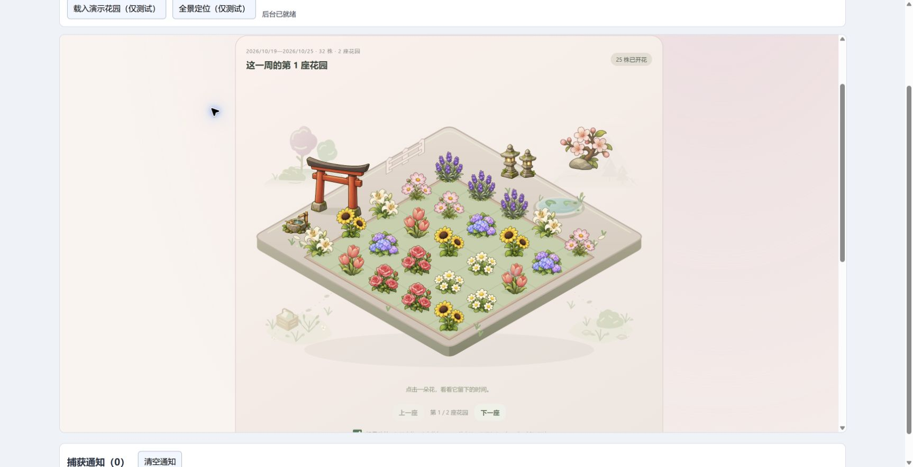
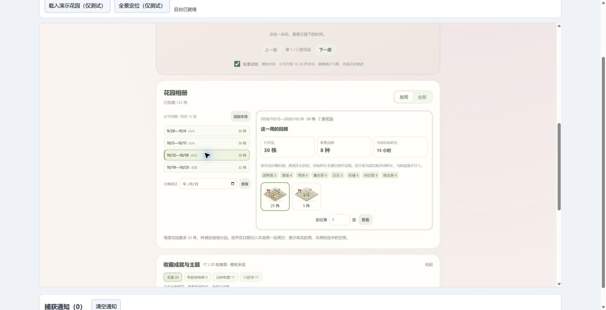

# Time Garden

[简体中文](intro/zh/README.md) · English

Grow a small garden while you use your computer. A third-party plugin for [Hindsight](https://github.com/Tomotsugu-dev/Hindsight), with cute, original AI-generated plants. No account, network connection or runtime dependencies.

## Features

- **Eight plants**: sunflower, hydrangea, tulip, daisy, rose, lavender, cosmos and lily, each with five growth stages.
- **A complete garden scene**: finished flowers grow on an isometric garden island with paths, pond and fence. The flowerbed area is 23.5% larger, with surrounding decorations scaled to 80%; the island, bed and planting positions retain one symmetric 4/7 projection. Layered trees, distant hills, a seed basket, ferns and small verge details frame the four corners behind the island and are omitted from thumbnails. The watering can has one close-fitting base shadow, and the swing seat's small shadow follows its illustrated direction even with motion off. Names and records stay hidden until you choose a flower; close its details to return to the whole garden.
- **A compact garden album**: weekly mode opens by default, with earlier-to-later weeks in a bounded, internally scrolling index and the selected week's review and small garden previews beside it. Narrow windows stack these sections. Weeks and thumbnails each use groups of at most 12; date navigation jumps directly to any local week, including an empty one. A short transition accompanies explicit week changes and respects reduced-motion settings.
- **Saved planting plans**: save up to 20 named sets of species, target time, rules and penalty settings. Plan choices show your name, the current category/rules and target minutes without rewriting saved names. Load, update or delete a plan, or reuse the last planting settings, then confirm the next planting yourself. Enter in the plan-name field saves a plan without planting. Flower names and task notes are not copied into plans.
- **Weekly review**: see completed flowers, species and completed goal time for the selected bloom week, with a species breakdown. These totals exclude the current pot and describe the flowers' goals, not actual time spent during that week.
- **Task memories**: optionally leave up to 280 characters when planting and edit the note later on the active pot or in the flower drawer. Notes stay local and are omitted from bloom notifications; old flowers receive no invented history.
- **Twenty permanent achievements**: reach nine bloom-count milestones from 1 to 1,000, three species-count milestones and the first bloom of each of the eight plants. A compact filterable list opens achievement conditions, progress and rewards in a right-side nonmodal drawer. Earned badges remain after flowers are removed.
- **Complete visual themes**: meadow keeps the original swing, wooden sign and watering can. Unlocked rain, dusk and blossom themes replace these three props with their own original illustrations and recolor the lawn, island faces, flowerbed, water, fence, paths and distant scenery. The scene and album thumbnails share the same theme; flower art receives no color filter. Themes change appearance, not growth rules.
- **Flower details beside the garden**: click a flower to open a nonmodal drawer on the right without scrolling below the scene. Other flowers remain clickable and update the drawer. Rename or remove a flower there; close with its close button, Escape or a click outside.
- **Gentle ambient motion**: the meadow swing sways lightly; the other themes use still props with simple fixed shadows. Small blue tits, robins or greenfinches and lilac, honey-orange or sky-blue butterflies visit the large scene alongside soft pond ripples and reflections. Visitor timing is unchanged, and thumbnails stay still. Motion can be disabled and follows reduced-motion settings. Disabling it, leaving the garden tab or hiding the page cancels current flights while retaining the next-visit wait, and pauses continuous effects.
- **Denser current-pot layouts**: at 540 CSS pixels and wider, an active plant and its progress sit beside its rules, task memory and notification setting. The planting form places saved plans and eight plant choices on the left, and the new flower's settings on the right. Narrow windows stack the sections; the separate compact-pot view keeps its existing layout. The high-definition gallery remains expandable.
- **Two illustration roles**: the planting form offers high-definition potted plant art in its optional gallery. The garden uses separately generated, simplified ground-planted flower sprites, without pots or permanent labels.
- **Plant stories to read offline**: all eight gallery entries include origins, a short story and a clearly qualified cultural or garden-created meaning, with sources from Kew, RHS, universities and Greenaway's public-domain flower-language book. See the [complete source notes](docs/plant-guide-sources.md).
- **Use your Hindsight categories**: pick an existing category or super-category from a dropdown. No need to re-enter the apps and websites assigned to it. App/domain rules remain available, and any matching rule grows the current plant without multiplying time.
- **Change rules while growing**: edit the active pot's rules without resetting its progress, target or penalty settings.
- **Cumulative growth**: collect time across visits and days. Switching away pauses growth by default.
- **Optional interruption penalty**: after a grace period, subtract either a percentage of the current progress or a fixed number of minutes. Each uninterrupted visit to other apps applies at most one deduction. Progress never goes below zero.
- **A lasting garden**: completed plants remain in your collection, with names and planting/bloom dates. The fixed 200-plant limit is removed; one plant grows at a time, and old flowers are never automatically deleted.
- **A little window**: compact view shows just the current pot. Bloom notifications are optional and silent; their single control lives in the planting plan or the active pot's plan card, without a separate settings card below.

Manual pause, an away event, background restart and an unobserved clock gap do not cause a penalty. Closing the plugin page does not stop its background worker while Hindsight is running.





[Flower detail overlay](docs/screenshots/drawer.png)

[Two-column planting layout](docs/screenshots/current.png) · [Two-column growing pot](docs/screenshots/growing.png)

[Plant stories and meanings](docs/screenshots/guide.png)

[Collection achievements and themes](docs/screenshots/collection.png) · [Achievement details](docs/screenshots/achievement.png)

[Rain theme](docs/screenshots/rain.png) · [Dusk theme](docs/screenshots/dusk.png)

Preview with synthetic test data. Scenery is original; plant art was created for this plugin with the built-in image generation tool.

## Install

Requires Hindsight **0.10.0 or later**. Version 0.12.0 is a prerelease of an experimental personal plugin, not an official Hindsight plugin. Basic functionality is usable, and development and iteration are ongoing. It has not been exhaustively tested and may contain problems or risks.

1. Download the prerelease `hindsight-garden-0.12.0.zip` from [Releases](https://github.com/Yoshino2000/hindsight-garden/releases), or build it below.
2. In Hindsight, open **Settings → Plugins** and choose the local ZIP installation option.
3. Review the seven permissions and the 64 MB database allowance, then install.
4. Open **时光花园**, pick a plant, give it a name and select a Hindsight category or group. App/domain rules are optional.

**Back up the plugin database before upgrading.** Make the backup while Hindsight is stopped, or use SQLite's online backup facility for a consistent backup while it runs. Install this ZIP as an update to the same plugin rather than deleting its data. Version 0.12.0 retains schema 2, seven API permissions and the 64 MB allowance. Upgrading from 0.11.0 reuses its permanent collection counters to award newly eligible achievements once, retaining the original four achievement dates. Newly awarded dates record this verification, not guessed historical dates. Older gardens first establish their collection baseline from the remaining archive; previously deleted flowers cannot be recovered for it. The increase from 4 MB to 64 MB was introduced in 0.5.0; an upgrade from 0.1.0 also includes the three category permissions introduced in 0.2.0.

**Do not downgrade or run old and new versions together.** Version 0.11.0 rejects the new achievement IDs; versions 0.5.0–0.10.0 cannot preserve the plan, milestone and task-note fields, and a persistent database guard blocks their incompatible writes. An old page or worker can therefore report an error; close it and reopen the latest version. To return to an older release, restore a consistent backup made before upgrading. A matching schema number does not guarantee safe downgrade compatibility.

An upgrade from a schema-1 version atomically migrates its garden to schema 2, keeping completed plants in individual SQLite archive rows and retaining the active plant, progress and settings. If archiving fails, the migration transaction rolls back and the old records remain. Plugin versions before 0.5.0 cannot read schema 2: do not directly downgrade to them; restore the backup made before migration if you need to return. An existing pot's **修改规则** action still lets it use categories without planting again.

Each garden shows up to 25 real completed flowers, filling from the center outward. When a week has more than 25 flowers, a second garden, then a third, holds the rest. The fixed plant-count cap is removed, but the 64 MB database allowance, host limits and available disk space still apply. When storage is full, old records are retained and the plugin reports insufficient space; it does not silently delete flowers. In the whole-collection view, plants use a stable planting-date/ID order. The scenery is decorative; it does not add fake flowers or completed time.

Weekly gardens use each plant's **bloom date**, not its planting date. A week runs from local Monday at 00:00 to the next Monday at 00:00, excluding that final instant. The index includes this week, historical weeks with flowers and a selected empty week; date navigation can select another empty week. The album starts in weekly mode even if an older version saved whole-collection mode; saved week and garden-page choices remain available. The review sums the goals of flowers that bloomed in the selected week, including flowers grown across several weeks. It cannot reconstruct daily use or time lost to penalties. Removing a flower changes the current collection's review, while earned milestones remain.

Selecting a flower opens its dates and controls in the right-side overlay drawer. Changing the view mode, week, garden or tab clears the selection and closes it; background refresh does not open it automatically. Closing it does not move the page to a lower details section. Garden display preferences remain local and separate from the saved collection, compact-view preference and ambient-motion preference. Pausing decorative motion does not pause plant growth.

Switching tabs clears old success messages and page-action errors. A current background runtime error remains visible so navigation cannot hide a stopped worker.

Version 0.12.0 passes 125 automated tests and has 22 connected-Chrome result records using isolated synthetic data; the final ZIP has not yet been installed in a native Hindsight instance in this round. Earlier-version checks do not establish native verification of this version. See [verification](docs/verification.md) for recorded results and [the 0.12.0 feature notes](docs/features-0120.md) for behavior and upgrade details.

The default opens in a separate **ordinary window**. Its title bar, background and overlap with other windows are controlled by Hindsight. Transparent desktop overlays, always-on-top, click-through and autonomous window movement are not supported. Use Hindsight's plugin settings to change where the page opens; compact view only changes this plugin's layout.

## Growth rules

The target is 1–1,440 minutes. Category rules use Hindsight's stable category IDs; super-category rules match any category currently assigned to that group. Renaming a category does not change the rule. Deleted categories do not match; use **刷新分类** to refresh names and choices. Assignment changes take effect when Hindsight reports a new foreground event. The plugin does not copy category memberships or edit Hindsight's classifications.

App rules can match a whole app name or part of it, ignoring case and a trailing `.exe`. Website rules match a domain and its subdomains on label boundaries: `example.com` includes `docs.example.com`, not `notexample.com`. A full URL is reduced to its hostname; page paths are not tracked. Multiple rules are alternatives.

Optional penalties have a 0–300 second grace period. A percentage applies to the accumulated progress at the time of deduction, **not the target**. For example, 40 accumulated minutes with a 10% penalty becomes 36 minutes. A five-minute penalty leaves 35 minutes. Returning within the grace period cancels it. Away/manual pause cancels a pending deduction; returning from a break does not itself incur a penalty.

Time means observed, matching **foreground use**, not proof of attention or completion. Hindsight's sampling and idle settings affect it. Background tabs do not count. A worker restart waits for a fresh focus event. A gap over ten seconds or a backwards clock change discards that unobserved stretch and waits for a fresh event. No offline time or past Hindsight activity is backfilled. Page commands may conservatively lose a partial tick rather than invent usage.

## Data and permissions

| Permission | Why |
|---|---|
| `focus.changed` | Observe foreground changes and away events |
| `focus.app` | Match app rules |
| `focus.title` | Obtain the website domain; the API also exposes window titles, which this plugin discards |
| `focus.category` | Match the current foreground category and its super-category |
| `categories.read` | List existing Hindsight categories for the dropdown |
| `super_categories.read` | List existing Hindsight super-categories for the dropdown |
| `notifications` | Send an optional bloom notification |
| `storage_mb: 64` | Store the current plant, preferences and individual completed-plant archives in this plugin's SQLite database |

No history/statistics, screenshot, file-system or program-launch permission is requested. The runtime makes no network requests. It does not keep window titles or an activity history. Rules, selected category IDs/names, plants, optional task notes, planting plans, milestone progress and the latest observed app/domain/category stay in the plugin's local database. Theme and other display preferences use local storage. Hindsight does not sync plugin databases across devices. Uninstalling can delete the garden if you choose to remove plugin data.

## Development

The structure follows the author's [Focus](https://github.com/Tomotsugu-dev/hindsight-focus) plugin: classic JavaScript, `importScripts`, small pure rules, a SQLite store and a plain DOM page. Its implementation and illustrations are original. See [development notes](docs/development.md), [artwork](docs/artwork.md), [verification](docs/verification.md) and [release procedure](docs/releasing.md).

```text
npm test
python scripts/package.py
python scripts/preview.py --port 8766
```

Tests need Node 22.13 or later and Python 3.11 or later for the SQLite host-limit checks. On Windows, tests use `py -3`; on other platforms they use the `PYTHON` executable path, if set, or `python3`. Tests use bundled frozen 0.4.0 fixtures and do not need Git history or network access. Packaging and preview use Python 3 standard-library modules. The preview also needs a sibling `Hindsight` source checkout to extract its actual page/worker bridges. Visit `http://127.0.0.1:8766`; its focus events and notifications are simulated, and its SQLite database is temporary. Preview tools and test data are excluded from the installable ZIP.

Code is under the [MIT license](LICENSE). Plant art was created with the built-in image-generation tool; its prompts and provenance are documented separately. Public-market listing requires a maintainer-reviewed pull request and is not implied by a local build.
