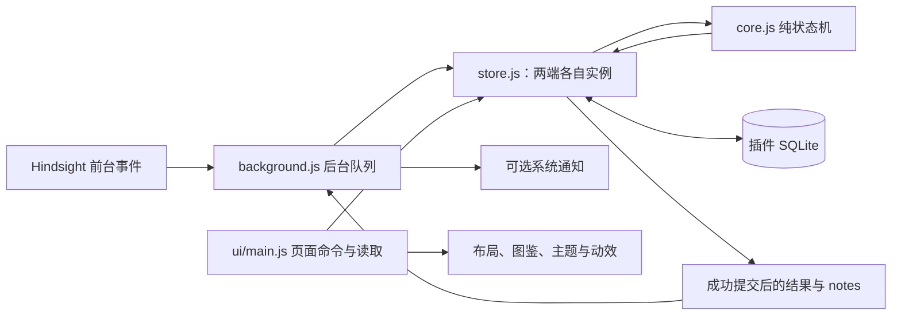

# 时光花园开发交接

编写日期：2026-10-26。面向后续开发者及接手本项目的 AI 助手。

本文以 **0.17.0 / `6851b0385a4856ee03121e071b710ab4c0913cdd`** 为代码基线，整理开发过程、设计理由、已经踩过的坑和接手方式。历史版本的尝试不等于当前行为；下文的“当前”均指这个基线。交接文档本身不属于已发布的 0.17.0 安装包。

## 1. 先了解交接状态

| 项目 | 已核验状态 |
|---|---|
| 插件 | 时光花园，ID 为 `hindsight-garden` |
| 源码仓库 | [Yoshino2000/hindsight-garden](https://github.com/Yoshino2000/hindsight-garden) |
| 当前发布 | [0.17.0](https://github.com/Yoshino2000/hindsight-garden/releases/tag/0.17.0)，标记为预发布 |
| 发布包 | `hindsight-garden-0.17.0.zip`，29,316,787 字节，98 个文件 |
| ZIP SHA-256 | `23faebf8876d21a1c60b09224d23f1dfa248b88cf9d7a95d9a07ec591ffa7624` |
| 插件市场 | [Tomotsugu-dev/hindsight-plugins](https://github.com/Tomotsugu-dev/hindsight-plugins) |
| 本版市场提案 | [PR #8](https://github.com/Tomotsugu-dev/hindsight-plugins/pull/8)，本次核验仍为 **OPEN**，官方 listing 检查通过；不能把 Release 已发布等同于市场已合并 |
| 发布基线测试 | 233 项通过，0 失败、0 跳过；干净源码重建 ZIP 逐字节一致，公开下载与本地包一致 |
| 持久化 | 归档 schema 2、成就 revision 4、64 MB 插件存储额度 |
| 当前内容 | 8 种植物，各 1 种隐藏配色；52 级成就，合并为 26 张卡片；4 个主题；中英日界面 |
| 未完成的验证 | 最终 ZIP 的原生 Hindsight 安装、真实 OS 通知投递、长期/跨平台/GPU 表现，不能用浏览器检查代替 |

PR 状态、宿主 API 和市场规则可能继续变化。接手时先核验，不把这个时间点的状态当永久事实。发布包身份以 tag、版本和 SHA-256 为准。

建议阅读顺序：本文 → [0.17 审查报告](audit-0170.md) → [验证记录](verification.md) → [开发说明](development.md) → [发布流程](releasing.md)。开发说明包含历史版本段落，遇到冲突先看当前代码和最新验证记录。

## 2. 产品从哪里来，为什么这样做

最初的目标很小：把用户在电脑上进行某些活动的时间，变成一盆逐渐生长的花。随后用户希望花开后还能长期收藏，花园能够按周回看，并且有更完整的场景、植物故事、任务记忆、主题和收藏惊喜。

这不是一个独立的系统监控程序。Hindsight 负责提供前台活动和分类，插件负责匹配用户规则、累计有效生长、保存结果及展示花园。普通 JavaScript、SQLite、SVG/CSS 和本地图片就能完成主要工作，因此一直保留小模块结构，没有引入前端框架或运行时打包器。参考了作者 Focus 插件的组织方式，规则、界面和素材独立实现。

用户提供的 Forest 截图、产品分析文章及时间管理 App 论文，主要带来这些设计启发：时间应能沉淀成可回看的物件；开始操作要短；长期收藏不能越用越难找；反馈应帮助用户理解发生了什么。它们没有证明本插件能提高效率或改变行为，也没有被当作最新版 Forest 的完整评测。历史阅读取舍见 [Forest 设计笔记](design-notes-forest.md)。

开发中逐步明确了几条产品原则：

- **允许按自己的活动种花。** 用户可以选学习，也可以选娱乐。匹配某个分类不等于证明“真正专注”或“完成任务”。
- **默认累计、暂停不惩罚。** 桌面活动经常需要切程序、查资料。严格中断扣减保留为自愿设置，不默认套用离开即枯萎。
- **花园保留历史。** 满了就分园，不能为了继续种花强迫用户删旧花。取消 200 株上限不代表无限物理存储。
- **回顾必须符合数据来源。** 目标时长、观察到的生长时间、实际完成了什么，是三件不同的事。
- **动态服务于氛围。** 用户多次要求更克制、更慢，最后采用同步轻风、偶发访客和小范围水光，而非持续大幅晃动。
- **减少填写和找信息的成本。** 接入现有分类，保存方案，推荐花名；宽窗两列、窄窗堆叠；详情从右侧叠加出现。
- **本地、离线、少保存。** 不增加账户、云服务、排行榜或金币经济。任务记忆由用户自愿填写，不从活动标题猜测。

## 3. 开发过程：0.1.0 到 0.17.0

下面按 Git tag 和实际提交梳理。它既说明做过什么，也说明每次变化要解决什么问题。

| 版本 / 提交 | 当时的问题或反馈 | 实现与取舍 |
|---|---|---|
| 0.1.0 · `65f6214` | 先验证“活动时间养花”能否成立 | 建立累计生长、规则、中断设置、本地存储和基本盆栽页面 |
| 0.2.0 · `0865535` | 手填程序名不方便，已有 Hindsight 分类可用 | 接入分类和大类，以 ID 匹配，名称用于显示 |
| 0.3.0 · `1f917f8` | 单盆缺少收藏的画面感 | 扩展到八种植物，加入等距花园及独立地栽素材 |
| 0.4.0 · `ae95990` | 花园种满后怎么办，希望按周展示 | 每园 25 株，加入周/全部视图、分园和选择；这时仍有总量限制 |
| 0.5.0 · `b5286e9` | 不想靠删旧记录继续种花 | 取消 200 株固定上限；schema 1→2，成熟花逐株归档；额度 4→64 MB；相册按有限窗口展示 |
| 0.6.0 · `0594623` | 相册过大、主次颠倒，想要轻动态 | 缩小缩略图、全景放上方；加入原创建筑/访客素材和初步环境动效 |
| 0.7.0 · `c1774a6` | 花圃仍错位，鸟没有扇翅，摆设缺影子 | 统一全岛/花圃/落点投影；增加多种鸟及翅膀姿态、蝴蝶配色和阴影，调整当前盆栽的信息布局 |
| 0.8.0 · `c647100` | 秋千越界、外围过大、局部影子不贴地 | 花圃面积增加、外围缩小；修水壶/秋千影子；图鉴缩图并补来源、故事与花语 |
| 0.9.0 · `bb1ac93` | 点击花后信息跑到底部，按周入口太深 | 改成右侧非模态详情；周选择提到一级；缩小鸟，加入四角远景 |
| 0.10.0 · `5314dee` | 周选择不直观，四角仍空 | 按较早到较晚整理时间线，丰富远景，阅读 Forest 产品分析并记录取舍 |
| 0.11.0 · `84a4cbf` | 周多后页面太长，希望有方案、回顾、记忆与奖励 | 紧凑周索引与固定面板、切周过渡；方案、任务备注、周回顾、永久收藏计数、首批 4 个成就和主题 |
| 0.12.0 · `df174a2` | 当前页面稀疏，主题只换小配饰，成就太少 | 两列布局与方案标签；20 个成就条件；主题覆盖整体配色并使用专属家具 |
| 0.13.0 · `0522964` | 重复计数成就占空间、命名费事、主页文字太多 | 分组合并成就；分类/预设任务推荐名；扁平图标；实际截图为主的中英主页 |
| 0.14.0 · `793cca5` | 更多周如何展示、空白太多、主题动效看不清 | 明确每页 5 周；动效开关上移；五档徽章与完成整组才填色；主题专属效果 |
| 0.15.0 · `798c226` | 落樱/水面不明显，希望知道为什么没生长 | 明确樱瓣从顶部落地渐隐；四主题水波与荷叶漂动；有效生长统计、连续/分类比例成就、可解释状态；36 级成就 |
| 0.16.0 · `b2bc364` | 想有隐藏配色、多语言、更简洁图标和雨夜氛围 | 独立 5% 隐藏配色与永久计数；52 级/26 卡；自动中英日；透明绿线图标；持续小雨和暖灯 |
| 0.17.0 · `6851b03` | 花朵要随风动并有影子，检查极端条件与性能 | 共享轻风和贴地影；根据反馈调慢；修计时/会话/版本边界；只读快照与视图缓存；形成完整审查记录 |

贯穿这些版本的经验是：用户截图暴露的往往是“系统不一致”，不是某个像素需要挪一下。地形问题最终靠统一投影解决；收藏问题靠存储和分页一起解决；动态问题靠可见度、频率、暂停和成本一起解决。

## 4. 当前架构与数据流



**页面和 Worker 是两个运行环境。** 它们加载同一套模块，但没有共享页面变量、单例或 `localStorage`。页面内的只读快照也只属于那个页面的 store 实例。SQLite 才是两端持久状态的协作通道。

### 4.1 接手时先看哪些文件

| 文件 | 负责什么 | 修改时最重要的约束 |
|---|---|---|
| [background.js](../background.js) | 接收事件、排队、2 秒 tick、通知 | 保存内部接收时刻；旧实例不能干扰新 owner；通知在落库后 |
| [core.js](../core.js) | 匹配、增长、扣减、开花、方案、成就与统计 | 纯状态转换；不在 reducer 中直接通知或临时随机开奖 |
| [store.js](../store.js) | SQLite、CAS、归档、升级与缓存 | 原子提交；保留旧元数据；重试不丢进度、不重抽 |
| [garden-layout.js](../garden-layout.js) | 周归属、排序、25 个槽位、分页、回顾、视图选择器 | 统一几何；不可变引用契约；不按空年份逐周遍历 |
| [ui/main.js](../ui/main.js) | 页面状态、命令、轮询与抽屉 | 不自己观察前台；异步结果过期保护；展示缓存与详情刷新分开 |
| [i18n.js](../i18n.js) | 中英日文案及模板 | 只翻译内置内容，不翻用户名称、备注和分类 |
| [ui/collection.js](../ui/collection.js) | 成就分组、主题解锁、方案标签与推荐名 | 展示分组不替换持久成就 ID，不伪造已获等级 |
| [ui/focus-status.js](../ui/focus-status.js) | 解释生长或暂停原因 | 缺信息、未匹配、已删除、读取失败要区别处理 |
| [ui/variants.js](../ui/variants.js) | 隐藏款花瓣选择性换色 | 保留绿叶、花盘、轮廓和原 alpha；滤镜 ID 唯一 |
| [ui/ambience.js](../ui/ambience.js) | 鸟蝶调度、固定主题装饰层 | 访客少量定时器；不逐帧跑 JS；缩略图静止 |
| [ui/breeze.js](../ui/breeze.js) / [CSS](../ui/breeze.css) | 同步风和粗略地影 | 任意时刻最多一个共享 timer；花和影同时重启、同时停止 |
| [ui/themes.css](../ui/themes.css)、[theme-effects.css](../ui/theme-effects.css)、[pond.css](../ui/pond.css) | 整体颜色、雨/樱/灯、池塘 | 不改变地形和生长；效果与地物位置、运动设置一致 |
| [scripts/preview.py](../scripts/preview.py) | 隔离模拟宿主 | 临时数据、真实提取桥、严格 CSP；不是原生安装证明 |
| [scripts/package.py](../scripts/package.py) | 白名单打包与校验和 | 新模块/素材/文档要登记；宿主注入桥不能打进 ZIP |

正式运行不需要 Node 或 Python；它们用于开发、测试和打包。模块采用普通脚本和条件 CommonJS 导出，便于同一套纯逻辑在宿主与 Node 测试中复用。

### 4.2 存储分工

| 数据 | 位置/字段 | 要记住的语义 |
|---|---|---|
| 当前盆栽与运行状态 | `garden_store` 的 `state` 行 | 一个活动盆栽、暂停、观察状态、owner、心跳、错误等 |
| 成熟花 | `garden_plants(id, value)` | 逐株 JSON；保存名称、品种、日期、目标、任务备注、配色；保留旧额外字段 |
| 归档修订 | `garden_archive_meta` | 归档变化才失效；不能拿 hot 行版本替代它 |
| 方案 | `plans`、`lastPlanting` | 可复用设置，不复制上一朵的名称或任务备注 |
| 普通永久收藏 | `collection` | 初次核验建立基线，之后开花增加，删除不减 |
| 已获成就 | `earnedAchievements` | ID→获得/核验时间，已获日期保留；时间戳 0 也有效 |
| 有效生长统计 | `focusStats` | 升级后实际观察到并增加进度的时间；不倒推旧花历史 |
| 隐藏收藏 | `hiddenCollection` | 永久数量与发现品种，删除不撤回 |
| 隐藏随机签 | 活动盆栽 `variantRoll` | 播种或旧活动盆栽升级时持久化一次，开花时揭晓 |
| 展示偏好 | 页面本地存储 | 主题、动效、紧凑模式和选中视图，不作为 Worker 配置总线 |

schema 2 的热行不常驻整个成熟花数组。写归档时临时携带 `_archive` 差量，由 SQLite 触发器在同一次写入中处理归档，再移除该临时负载。

### 4.3 一次可靠写入如何完成

1. 读取热状态版本及归档修订。
2. 纯 reducer 计算这次动作后的状态与待交付 notes。
3. 同时校验两个版本，执行 CAS 更新。
4. 数据库触发器在同一个语句的事务里完成归档插入/编辑/删除及迁移。
5. 成功后才返回通知等副作用；冲突则重读重算。

**不能用多个宿主调用拼一个长事务。** 宿主每次数据库调用可能使用新连接，分开调用 `BEGIN`、修改、`COMMIT` 不能提供预想的原子性。这是从整园 JSON 改成逐株归档时最关键的实现约束。

## 5. 接手者必须保留的行为

### 5.1 生长、时间与规则

- 同时只有一盆；规则是 OR，匹配多个规则也只累计一次。
- 目标为 1–1440 整数分钟；可以多次、跨天完成。
- 默认切出规则只暂停；可选扣减有宽限，每次中断只扣一次，最低为零。手动暂停和离开电脑不扣。
- 只认可运行中实际观察到的时间。重启、离线、休眠和大于 10 秒的未观察间隔不补算；墙钟倒退也不补算。
- 分类用不透明、区分大小写的 ID 匹配，名称是显示标签，不以改名或程序列表推测 ID。
- `focus.changed.at` 不应一律当毫秒数字。当前内部结算用 Worker 接到事件时保存的 `observedAt`，与队列处理时刻、外部事件时间分开。
- 关插件页面不等于暂停，后台可以继续运行。需要停止生长应使用暂停或宿主的插件管理功能。

### 5.2 三种“时间”不能混用

| 指标 | 当前定义 | 不应描述成 |
|---|---|---|
| 盆栽进度 | 当前目标的净进度，可能被自愿惩罚扣减 | 所有电脑使用时间 |
| 周回顾完成目标时长 | 该周开花植物的目标总和，跨周植物全部归开花周 | 当周实际专注时长、每日流水 |
| `focusStats` | 统计起点之后实际获得的有效生长时间，已观察时间不因惩罚倒扣 | 升级前完整历史、任务成果、全部 Hindsight 活动 |

分类统计最多单列 24 个真实分类，其后新分类汇总为“其他”；未分类与其他都进入总量分母，但不作为比例成就的达标分类。成就的“条件进度”也不是实际分类占比。原始统计不足时保留未知，不能从花名、目标或备注补造。

### 5.3 收藏、布局与视觉

- 无固定 200 株上限，但有 64 MB 物理额度；满时明确失败并保留旧数据，不自动清理旧花。
- 每座 25 株；每组最多 12 个花园缩略图；周索引每页 5 周。从早到晚展示，按本地周一至周日、开花日期归周。
- 选中空周和本周可以存在；不能为了显示空周遍历几百年的每个星期。
- 排序以种下时间与 ID 为基础，槽位从中心向外，改名和轮询不重新洗牌。
- 单花详情在右侧非模态抽屉，保留键盘关闭、焦点和编辑状态，不能随轮询把用户正在写的内容覆盖掉。

投影统一为 1000×760 画布，轴向步长 `78.75 / 45`，斜率 **4/7**。岛面中心 `(500,400)`，花圃中心 `(500,450)`，左右对称轴为 `x=500`。花圃略靠前是给后侧家具留空间，不应为了“中心一样”就改掉它；对齐要检查边线、格线、根部和岛面是否共享同一投影。

### 5.4 成就、隐藏款与语言

- 52 个持久条件分组展示为 26 卡，不是用 26 个新 ID 替换原 ID。等级有白、蓝、紫、金、彩，只有整组全部达成才填淡黄背景。
- 永久计数与可删除档案分开。旧版已经删掉的花无法还原；升级核验日不能伪装成历史获得日。
- 每次完成独立有 5% 隐藏结果；实际随机签提前持久化，完成只揭晓。CAS 重试、刷新、重启不能重新抽。
- 旧在养盆栽升级时补签，旧成熟花保持普通色。品种、目标时长不改变概率，没有保底。
- 系统语言 `zh*`→简体中文，`ja*`→日语，英语及其他语言→英语。Worker 独立解析自己的环境语言。
- 用户花名、方案名、备注和分类名不翻译。内置空分类占位语需要翻译，但不能把用户真的命名成“未命名分类”的文字改掉。
- 名称 1–40、备注最多 280，当前 JavaScript/表单按 UTF-16 长度计数；推荐名截断要保留 emoji 的代理对。

### 5.5 动效的最终参数

| 对象 | 当前实现 |
|---|---|
| 花朵 | 所有普通/隐藏花同步，1.2–2°、4.5 秒一阵，结束后静歇 3–10 秒；任意时刻最多一个共享 timer |
| 花影 | `::before` 小椭圆，同节奏做少量位移/缩放；隐藏标记独立在 `::after` |
| 秋千 | 两层图集、约 ±4°、8.5 秒；家具位置和脚点受岛面范围约束 |
| 小鸟 | 三种鸟、三姿态图集；后续起飞间隔 15–30 秒，飞行 6 秒，翅膀独立切帧；首次演示等待较短 |
| 蝴蝶 | 三配色，偶发飞行和扇翅；与小鸟不是同一个调度范围 |
| 雨 | 六条固定错相路线，6.6 秒循环，少量同时下落，落在安全草坪后出现小水花 |
| 樱瓣 | 从场景上方下降到地面，停留后渐隐，不是原地抖动的粉色点 |
| 夜景 | 较暗的整体配色、已有三盏灯的暖光晕和地面柔光，不对整株植物套变色滤镜 |
| 池塘 | 四主题共用有裁剪的水波、反光和两组微漂荷叶；岸边植物不跟着漂 |

离开花园、紧凑模式、页面不可见、关闭动效或系统减少动态时停止相应运动。缩略图保持静止。花朵的“3–10 秒”是**停稳后的等待**，不是包含 4.5 秒动作的总周期；这是用户要求进一步放慢后的最终取舍。

## 6. 踩过的坑及避免方式

| 坑 | 当时如何暴露 | 后续避免方式 |
|---|---|---|
| 把页面变量当后台配置 | 页面关闭、重载后状态与 Worker 不一致 | 配置/运行状态通过 SQLite 协作，明确两端各自生命周期 |
| 整园 JSON 每两秒重写 | 200 株限制与数据越长越难保存 | 热状态和成熟档案分开；别把整园再塞回热行 |
| 多调用事务不成立 | 新连接无法延续前一次 `BEGIN` | CAS 与触发器在单次语句里原子完成差量和迁移 |
| schema 相同就以为能降级 | 旧 reducer 会归一化掉新增方案、统计或成就字段 | schema 与成就 revision、字段保护分别检查；测试实际旧运行时代码 |
| 一边修改数据一边通知 | CAS 重试或超时可能重复通知 | 落库后处理 notes；通知超时不擅自重发，因为可能已经送达 |
| 处理队列时才取时间 | 第 5 秒切出，写库堵到第 12 秒后把等待算进旧活动 | 保存内部接收时刻；过旧、倒退、早于新页面操作的观察要拒绝 |
| 只查“太旧”，不查负年龄 | 墙钟回拨后排队事件重新激活 | 同时检查倒退、观察间隔及状态已结算时刻 |
| 旧 Worker 迟到错误覆盖新状态 | 旧实例失败后清空新 focus，恢复时又抢 owner | 错误带身份，恢复带原 owner 条件；覆盖首次启动丢回执 |
| 版本号只做读取校验 | `MAX_SAFE_INTEGER+1` 写完，下一次却读不了 | 在写之前检查 hot 版本及预计归档修订，不靠清零“修复” |
| 深层旧额外字段用递归 JSON 拷贝 | 18,000 层记录读取栈溢出 | 迭代复制/冻结；不要裁掉旧字段。超过 SQLite 写回深度时友好拒绝编辑、保留原字节 |
| 每轮询又复制、排序、签整园 | 即使不重建 DOM，大收藏仍有 O(N) 开销 | 共享冻结快照+视图选择器；只签当前 25 株/可见缩略图字段 |
| 只用 length/ID 判断缓存有效 | 改备注、改名后长度不变，详情可能陈旧 | 归档修订变化就换数组引用；视觉签名与详情刷新独立 |
| 只修某个图层的偏移 | 岛面、花圃和根部反复“越修越歪” | 统一投影和几何参数，再检查整条边、所有脚点与左右轴线 |
| 秋千只增幅、不查边界 | 摆动或放大后越过岛面 | 家具、绳子、座板和影子在最大姿态都检查；不只看静止图 |
| 装饰影子都实时模糊计算 | 成本高，且方向不一定更准确 | 静物用固定 SVG 影；移动物体只用简单的低精度变换 |
| AI 图集按等宽五格裁 | 实际图片帧不等距，切出邻株或裁掉花头 | 保留源 PNG；依据 `FRAMES` / `GARDEN_FRAMES` 定位可见内容 |
| 对隐藏花直接整图转色 | 花瓣变了，绿叶也被染色 | 用选择性花瓣遮罩；向日葵还要亮度门控保护绿叶和深花盘 |
| 小图克隆重复 SVG ID | 渐变、裁剪或滤镜引用串到别的花园 | 缩略图背景 ID 加前缀；每个隐藏滤镜 ID 唯一 |
| CSS 动画名没变 | 第二次起风不重播，或花动但影不动 | 花与影均交替 a/b 名称；不要靠强制读取布局重启 |
| 为每株花建 timer | 页越多，计时器与暂停清理越复杂 | 只给主场景一个共有时钟；缩略图不挂动态层 |
| 动效过大、过快或太淡 | 用户看不到落樱/雨，或觉得风太急 | 用自然运行的截图和参数核查；最后花风从较快原型调为 1.2–2°/4.5 秒 |
| 全页面自动翻译 | 用户备注、名称或分类被误翻 | 初次静态文案翻译在个人状态渲染前完成；后续只调用明确的内置键 |
| 模拟页面语言就以为通知也变了 | 英文页面的 Worker 仍是本机中文 | 页面与 Worker 分开测，模板 VM、浏览器结果和 OS 投递分开报告 |
| 日期负时间被回退为“现在” | 1969 年选择悄悄变成本周，UTC+13 最早一天也有边界 | 显式校验 1970–9999；选日用本地 18 点找周；纠正日期时清除旧错误 |
| 新文件只放工作目录 | 本地调试看见，ZIP 或预览白名单却漏模块 | 同时检查打包/预览白名单、实际 ZIP 内容、脚本加载顺序和 CSP |
| PR 旧状态没刷新 | 上一版已经合并，却继续往已结束分支追加 | 发布前查 upstream 和原 PR；已合并就从新主分支开下一版 |
| 同版本替换 ZIP | 市场 SHA、缓存与已安装版本失去一致身份 | 发布物不可变；变更安装包就升版本，保留所有旧 ZIP/hash |
| 把漂亮截图当功能测试 | 无法证明迁移、后台计时、通知或性能 | 分开保留规则/存储/Worker/DOM/浏览器/原生证据 |

### 两个值得特别记住的边界

**深层旧元数据：可读不等于无限深可写。** 当前迭代读取可以处理测试中的 18,000 层额外字段，但现有 SQLite JSON 协议有深度限制。单株 997 层加上热状态差量的三层包装仍可编辑；更深的改名/备注会在写前明确拒绝。原值与两个版本号不变，仍可查看或由用户确认后移除。不要为了让编辑成功而悄悄删除未知字段。

**首次 ownership 读取前失败：安全优先于猜测。** 如果当前没有 owner，新前台事件可以恢复启动；如果有后来接管的新 owner，旧实例必须退让。首次读取前就失败且遇到未知非空残留 owner 时，无法安全证明它已经失效，当前选择保守退让，重新打开插件的新 Worker 可以正常接管。不要绕过身份保护强行恢复。

更完整的复现、测试名和测量口径见 [0.17 审查](audit-0170.md)。

## 7. 性能现状：优化了什么，还没优化什么

0.17 的关键不是“把 DOM 改成虚拟列表”，而是先消除未变化数据的重复工作：

1. 页面使用 `createStore(..., { readonlyArchive: true })`，相同归档修订返回同一深冻结数组。默认 store API 仍返回隔离的可变副本。
2. `createViewSelector()` 以数组引用、页/周/范围、当前本地周和时区缓存最近一个视图。不是看 length 或 ID 猜数据没变。
3. 未变化视图直接返回；主图只比较可见 25 株的展示字段，相册至多比较 300 株的图像字段。
4. 备注和离屏改名不无谓重建贴图，打开的详情独立刷新。
5. 未变化的统计不重新建 DOM；不可见页面暂停 UI 读取，恢复时刷新。Worker 计时没有因此停掉。

已保存的独立合成基准：Node 24.15.0、Windows、内存 SQLite、一盆活动植物、无保存方案；缓存每模式 12 次取中位数，单位 ms。

| 花朵数 | 普通缓存读取中位 | 只读缓存读取中位 | 只读首次加载单次值 |
|---:|---:|---:|---:|
| 5,000 | 4.408 | 0.152 | 46.213 |
| 20,000 | 17.763 | 0.143 | 191.281 |

另一个独立的纯布局基准中，25,000 株普通建视图 100 次为 2624.143 ms，缓存命中 100 次为 4.228 ms。两组基准测试的是不同路径，不能相加或换算成整个软件降低了多少 CPU，也不包含原生桥、磁盘、排版或 GPU。

仍存在的空间：首次载入和归档变化后会全档读取、校验、冻结；换页/换周的视图缓存未命中仍是 O(N)。52 条成就的有界更新也还存在，但没有证据证明它是当前随收藏增长的主瓶颈。需要更大规模时先测原生瓶颈，再考虑可迁移的索引或增量归周。

## 8. 本地接手与验证方法

### 8.1 环境与启动

项目声明 Node ≥22.13；本次完整验证环境是 Node 24.15.0、Python 3.14.4。不要把最低声明版本等同于所有宿主限制测试都已在那个版本上跑过；出现跳过时不能报告为完整通过。

以下在仓库根目录的 PowerShell 执行，路径按自己的工作区调整：

```powershell
git status --short
node --version
python --version
npm test
```

本地预览：

```powershell
python -X utf8 scripts/preview.py --port 8773
```

预览脚本默认到相邻 `Hindsight/src-tauri/src/plugins/file_reader.rs` 提取 PAGE_JS/WORKER_JS。没有相邻宿主源码时先准备或明确调整该开发路径；不要把桥文件复制进发布包，也不要为了能打开页面而去掉沙箱/CSP。

浏览器打开 `http://127.0.0.1:8773/`。这是临时数据库的模拟宿主。它有明确的种花/分页/大收藏/配色演示夹具，控制按钮不属于生产插件 API。终端是常驻服务，验证完停止自己启动的服务；无需改 PATH、系统编码、全局执行策略或 shell profile。

### 8.2 最小检查组合

| 改动类型 | 应有的检查 |
|---|---|
| 规则/计时/惩罚 | reducer 与 Worker 时钟测试；切出、离开、暂停、睡眠间隔、倒退、队列阻塞 |
| 存储/新字段 | CAS、迁移中途失败、配额失败、实际旧运行时、归档编辑、原字节保留 |
| 布局/缓存 | 稳定槽位、分页、空周、跨年/DST/时区、同长度改名、备注详情与节点复用 |
| 动效/素材 | 运行中的自然帧、最大姿态脚点、影子/标记分层、缩略图、开关、不可见和减少动态 |
| 多语言 | 英/日/未知语言回退、占位符、内置错误、用户原文与 Worker 模板 |
| 发布 | 干净源码测试、打包白名单、公开下载 hash、重建一致、最新版图标和官方 listing 检查 |

`test/ui-render.test.cjs` 执行实际渲染函数，但只使用最小 DOM 树；它能查节点和状态，不能代替浏览器排版。`test/fixtures/` 中有冻结的旧 core/store，维护迁移保护时不要用当前代码冒充旧版。

可选性能基准：

```powershell
node test/store-performance.cjs
```

没有耗时断言，也不访问个人数据。单独运行并保存环境/样本口径，避免与完整测试同时争用 CPU。只改文档等低影响内容，不必机械重跑整套运行时测试。

### 8.3 发布流程

1. 更新 `manifest.json`、`package.json` 的同一个新版本，并完成适用验证；明确仍未执行的项目。
2. 检查新运行模块、图片和文档已进入 `scripts/package.py` 白名单，预览新文件也要进入 `scripts/preview.py` 的允许列表。
3. 在干净源码副本运行测试与构建，不依赖工作目录私有文件：

   ```powershell
   python -X utf8 scripts/package.py
   ```

4. 核对 ZIP、`.zip.sha256` 和 `dist/market-entry.json`；同一源码构建应逐字节一致。构建脚本本身不发布。
5. 发布源码 tag 和 GitHub Release，ZIP/hash 作为 release assets。开发阶段保留预发布及“基础可用、仍在迭代、验证未全面”的说明。
6. 从公开 URL 下载，与本地 ZIP/hash 对比；发布物一旦进入列表就不原地替换。
7. 在市场仓库先 fetch upstream，确认上一 PR 是否合并；从最新主分支建立本版分支，只增加本插件版本条目，保留所有旧版本。最新版包内 `icon.png` 与市场图标必须逐字节一致。
8. 在市场 checkout 提交修改后运行官方检查：

   ```powershell
   git fetch origin main
   python -B -X utf8 scripts/check_listing.py origin/main HEAD --author Yoshino2000
   ```

9. 提 PR，核对远端 head、正文、Release 链接和最新 head 的 CI 结果。不要把本地命令执行成功当成远端发布成功。

市场格式当前使用 format 2，和本地 ZIP 安装兼容要求是两个层次。既有说明记录 Hindsight 0.10.2+ 支持市场 format 2，后续发布需重新核对作者当前规范。不要直接整份覆盖市场索引或修改其他插件。

## 9. 验证证据与个人数据要分开放

0.17 基线已有这些证据：233 项自动测试、干净源码重建一致、公开 ZIP/hash 一致、官方市场检查通过；浏览器实查四主题、自然慢风、隐藏花、日期、备注与窄窗口。5,001 株夹具挂载 25 株全景和 300 株缩略图，观察两分多钟节点未重建。

但以下不能写成“已验证”：最终包在原生 Hindsight 安装成功、真实前台捕获链路全部正确、OS 通知实际送达、所有系统/显卡/长期运行资源表现。Worker VM 验证通知模板不等于系统通知，截图不等于完整动画频率测量，纯 Node 基准不等于整机耗时。0.17 原始浏览器日志还有一条其他扩展异常，插件来源日志为空；二者已分开，没有把其他扩展异常当成本插件 bug。

仓库中的 `output/`、`dist/`、数据库及缓存有忽略规则。0.17 本地证据主要在 `output/verification/`，不随源码 checkout 或安装 ZIP 分发；公共可读结论在 [验证记录](verification.md) 和 [审查报告](audit-0170.md)。临时辅助脚本可能还在仓库外的 QA 目录，不是运行时依赖。

历史上曾按用户要求向本地插件加入 **120 株演示花**，ID 前缀为 `demo-20261025-`。本地 `output/local-preview/20261025-134639/` 留有清单、备份与管理脚本。这些不是用户真实专注成果；近期浏览器的 8 普通＋8 隐藏对照也不是概率抽样。不要把演示数量解释为用户历史或成就验证结果。

该本地目录可能包含个人数据库备份或路径，不能随交接文件公开、打入 ZIP 或上传市场。接手时无需读取真实数据库就能跑测试。确需操作真实数据，先确认用户授权、停止相关运行时或使用 SQLite 一致备份，保留原文件和演示 ID；不要自动重跑 seed、undo 或通用清理脚本。

## 10. 后续优先级与未做事项

以下是接手建议，**没有在本轮自动开始实施**：

1. **先补最终包原生验收。** 使用隔离 Hindsight 数据目录，确认安装/升级、后台关闭与恢复、实际分类、OS 通知和旧数据保护。
2. **测真正的大收藏首载与长期资源。** 分开测 IPC、SQL、归档解析、布局、图片解码和 GPU；有证据后再决定增量索引或分页读取设计。
3. **持续验证信息密度和动效节制。** 宽窗与实际 460×720 初始窗都要看，关注编辑焦点、空状态、全主题、减少动态和语言长度。
4. **如做每日图，先设计数据契约。** 当前没有逐日流水，必须从新增记录起点开始，处理午夜/DST/扣减/CAS/配额，不能把旧目标时长换名称充当历史专注。
5. **导出、分享、同步和自由摆放需单独立项。** 目前没有本地分享卡、自动任务识别、社交排名或云同步；二维素材也不能直接承诺 3D 旋转。

新增持久字段时先设计旧版本保护；新增成就保留原 ID 和日期；新增语言保留用户文本；新增动画先列出暂停与清理条件。继续按照“先复现与量化，再做最小修复，最后验证最终包”的方式迭代。

## 11. 文档与素材索引

- [用户说明](usage.zh-CN.md)：操作、权限、数据和升级边界。
- [开发说明](development.md)：模块、数据契约和历次实现细节；注意其中历史段落。
- [发布流程](releasing.md)：不可变发布、格式和市场检查。
- [当前审查报告](audit-0170.md)：已复现问题、测试名、性能口径和剩余空间。
- [验证记录](verification.md)：按版本保留的结果与未验证项。
- [0.17 功能说明](features-0170.md)、[0.16 功能说明](features-0160.md)：近期行为与兼容变化。
- [Forest 阅读取舍](design-notes-forest.md)：0.11 阶段的历史设计快照，不是当前完整待办表。
- [植物素材说明](artwork.md)、[环境素材](artwork-ambience.md)、[鸟蝶图集](artwork-ambience-070.md)、[主题素材](artwork-themes-0120.md)：原始提示词、来源与图集约束。
- [植物介绍来源](plant-guide-sources.md)：图鉴内容的依据；不要凭新插画自行断言具体物种。

原 29 张植物/场景 PNG 在 0.17 保持不变；隐藏色是 SVG 选择性换色，图标是独立的透明绿色线条标记。增加新素材时延续现有风格和来源记录，检查真实透明通道与帧边界，保持图集、根部、投影和阴影约定一致。
