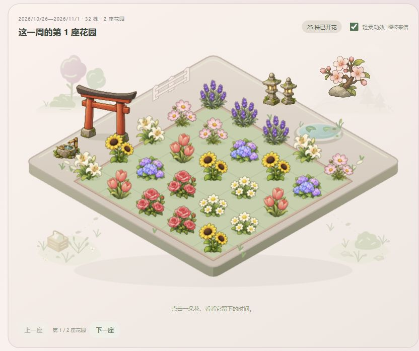
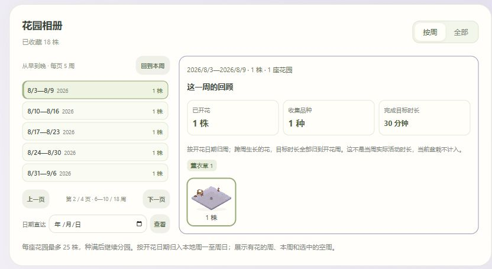

# Time Garden — detailed guide

[中文首页](../README.md) · [English home](../README.en.md)

Grow a small garden while you use your computer. A third-party plugin for [Hindsight](https://github.com/Tomotsugu-dev/Hindsight), with cute, original AI-generated plants. No account, network connection or runtime dependencies.

## Features

- **Eight plants**: sunflower, hydrangea, tulip, daisy, rose, lavender, cosmos and lily, each with five growth stages.
- **Eight hidden palettes**: each flower has one hidden color, with an independent 5% chance per bloom and no guaranteed drop. The saved result stays with the flower. Older mature flowers keep their original colors and are not rerolled.
- **Offline interface languages**: Simplified Chinese, English or Japanese follows the environment language when the page opens; other languages fall back to English. Saved flower names, notes and host category names are not translated or rewritten.
- **A complete garden scene**: finished flowers grow on an isometric garden island with paths, pond and fence. The flowerbed area is 23.5% larger, with surrounding decorations scaled to 80%; the island, bed and planting positions retain one symmetric 4/7 projection. Layered trees, distant hills, a seed basket, ferns and small verge details frame the four corners behind the island and are omitted from thumbnails. The watering can has one close-fitting base shadow, and the swing seat's small shadow follows its illustrated direction even with motion off. Names and records stay hidden until you choose a flower; close its details to return to the whole garden.
- **A compact garden album**: weekly mode opens by default, with five earlier-to-later weeks per page and the selected week's review and small garden previews beside it. Use previous/next pages when there are more than five weeks. Narrow windows stack these sections. Garden thumbnails still use groups of at most 12; date navigation reveals the page containing any local week, including an empty one. A short transition accompanies explicit week changes and respects reduced-motion settings.
- **Saved planting plans**: save up to 20 named sets of species, target time, rules and penalty settings. Plan choices show your name, the current category/rules and target minutes without rewriting saved names. Load, update or delete a plan, or reuse the last planting settings, then confirm the next planting yourself. Enter in the plan-name field saves a plan without planting. Flower names and task notes are not copied into plans.
- **Weekly review**: see completed flowers, species and completed goal time for the selected bloom week, with a species breakdown. These totals exclude the current pot and describe the flowers' goals, not actual time spent during that week.
- **Quick target durations**: type any minutes, or pick 30, 60, 90, 120 or 180 with one click.
- **A bloom card**: while the page is open, a card shows the new flower, its name and completed goal time the moment it blooms, with a separate reveal for hidden palettes. **Visit the garden** opens its garden page and details. A bloom that happened while the page was closed is revealed once on the next visit; with motion off, the card appears still.
- **Task memories**: optionally leave up to 280 characters when planting and edit the note later on the active pot or in the flower drawer. Notes stay local and are omitted from bloom notifications; old flowers receive no invented history.
- **Fifty-two permanent achievement levels in twenty-six display cards**: the original 36 levels cover bloom counts, species and observed effective growth; 16 new conditions cover hidden collections. Badge colours progress through white, blue, purple, gold and rainbow. Cards stay white until every level is earned, then fill pale yellow. Open their drawer for conditions, progress, rewards and earned dates. Removing flowers does not revoke achievements.
- **Complete visual themes**: meadow keeps the original swing, wooden sign and watering can. Rain, dusk and blossom replace those props and recolor the lawn, island faces, flowerbed, water, fence, paths and distant scenery. Main scenes and album thumbnails share the theme. Themes do not tint entire flowers or change growth rules; hidden palettes separately recolor selected petal regions.
- **Flower details beside the garden**: click a flower to open a nonmodal drawer on the right without scrolling below the scene. Other flowers remain clickable and update the drawer. Rename or remove a flower there; close with its close button, Escape or a click outside.
- **Gentle ambient motion**: meadow has its swing; rain has a steady sparse shower with small splashes on safe grass and a moving leaf canopy. Dusk is a little darker, with three local lamp glows, light on the lawn and occasional fireflies. Blossom petals settle and fade. All themes retain pond ripples, reflections and lily-pad drift. Bird/butterfly timing is unchanged. Thumbnails stay still; motion follows the switch, page visibility and reduced-motion settings.
- **A shared flower breeze in 0.17.0**: all eight flowers and hidden palettes sway together by about 1.2–2 degrees for 4.5 seconds, followed by 3–10 seconds of rest. Small ground ellipses move in phase rather than calculating realistic shadows per frame. All themes share the effect; previews remain still. Turning motion off, hiding the page, leaving the garden or enabling reduced motion stops it.
- **Denser current-pot layouts**: at 540 CSS pixels and wider, an active plant and its progress sit beside its rules, task memory and notification setting. The planting form places saved plans and eight plant choices on the left, and the new flower's settings on the right. Narrow windows stack the sections; the separate compact-pot view keeps its existing layout. The high-definition gallery remains expandable.
- **Two illustration roles**: the planting form offers high-definition potted plant art in its optional gallery. The garden uses separately generated, simplified ground-planted flower sprites, without pots or permanent labels.
- **Plant stories to read offline**: all eight gallery entries include origins, a short story and a clearly qualified cultural or garden-created meaning, with sources from Kew, RHS, universities and Greenaway's public-domain flower-language book. See the [complete source notes](plant-guide-sources.md).
- **Use your Hindsight categories**: pick an existing category or super-category from a dropdown. No need to re-enter the apps and websites assigned to it. App/domain rules remain available, and any matching rule grows the current plant without multiplying time.
- **Change rules while growing**: edit the active pot's rules without resetting its progress, target or penalty settings.
- **Cumulative growth**: collect time across visits and days. Switching away pauses growth by default.
- **Optional interruption penalty**: after a grace period, subtract either a percentage of the current progress or a fixed number of minutes. Each uninterrupted visit to other apps applies at most one deduction. Progress never goes below zero.
- **A lasting garden**: completed plants remain in your collection, with names and planting/bloom dates. The fixed 200-plant limit is removed; one plant grows at a time, and old flowers are never automatically deleted.
- **A little window**: compact view shows just the current pot. Bloom notifications are optional and silent; their single control lives in the planting plan or the active pot's plan card, without a separate settings card below.

Manual pause, an away event, background restart and an unobserved clock gap do not cause a penalty. Closing the plugin page does not stop its background worker while Hindsight is running.





[Flower detail overlay](screenshots/drawer.png)

[Two-column planting layout](screenshots/current.png) · [Two-column growing pot](screenshots/growing.png)

[Plant stories and meanings](screenshots/guide.png)

[Collection achievements and themes](screenshots/collection.jpg) · [Achievement details](screenshots/achievement.jpg)

[Rain theme](screenshots/rain.jpg) · [Dusk theme](screenshots/dusk.jpg)

Preview with synthetic test data. Scenery is original; plant art was created for this plugin with the built-in image generation tool.

## Install

Requires Hindsight **0.10.0 or later**, or **0.10.2 or later** for market installation. Version 0.20.0 is a prerelease of an experimental personal plugin, not an official Hindsight plugin. Basic functionality is usable, and development and iteration are ongoing. It has not been exhaustively tested and may contain problems or risks.

1. Download the prerelease `hindsight-garden-0.20.0.zip` from [Releases](https://github.com/Yoshino2000/hindsight-garden/releases/tag/0.20.0), or build it below.
2. In Hindsight, open **Settings → Plugins** and choose the local ZIP installation option.
3. Review the seven permissions and the 64 MB database allowance, then install.
4. Open **时光花园**, pick a plant, give it a name and select a Hindsight category or group. App/domain rules are optional.

**Back up the plugin database before upgrading.** Stop Hindsight or use SQLite's online backup facility to obtain a consistent copy. Update the same plugin without deleting its data. Version 0.20.0 retains schema 2, seven API permissions, 64 MB and achievement revision 4. The icon is unchanged; since 0.18.0, asset PNGs are resized to their display size with the same artwork. Existing flowers, progress, observed-growth statistics and earned dates are retained, including the original 36 conditions. Updating from 0.16.0 or later never redraws a hidden result. Older mature flowers are not rerolled; an older active pot receives one persisted ticket during upgrade and reveals its result at bloom. Earlier gardens still establish their ordinary collection baseline from the remaining archive; previously deleted flowers cannot be recovered. Upgrades from before 0.5.0 include the 4-to-64 MB allowance change, and upgrades from 0.1.0 include the category permissions introduced in 0.2.0.

**Do not downgrade or run old and new versions together.** Version 0.15.0 and earlier do not understand revision 4 and its hidden state, and can reject reads. Persistent database guards also reject writes that discard new fields or change the ticket of the same active plant. Close old pages/workers and reopen the latest version. To return, restore a consistent pre-upgrade backup. A matching archive schema number does not guarantee compatible state writes.

An upgrade from a schema-1 version atomically migrates its garden to schema 2, keeping completed plants in individual SQLite archive rows and retaining the active plant, progress and settings. If archiving fails, the migration transaction rolls back and the old records remain. Plugin versions before 0.5.0 cannot read schema 2: do not directly downgrade to them; restore the backup made before migration if you need to return. An existing pot's **修改规则** action still lets it use categories without planting again.

Each garden shows up to 25 real completed flowers, filling from the center outward. When a week has more than 25 flowers, a second garden, then a third, holds the rest. The fixed plant-count cap is removed, but the 64 MB database allowance, host limits and available disk space still apply. When storage is full, old records are retained and the plugin reports insufficient space; it does not silently delete flowers. In the whole-collection view, plants use a stable planting-date/ID order. The scenery is decorative; it does not add fake flowers or completed time.

Weekly gardens use each plant's **bloom date**, not its planting date. A week runs from local Monday at 00:00 to the next Monday at 00:00, excluding that final instant. The index includes this week, historical weeks with flowers and a selected empty week; date navigation can select another empty week. The album starts in weekly mode even if an older version saved whole-collection mode; saved week and garden-page choices remain available. The review sums the goals of flowers that bloomed in the selected week, including flowers grown across several weeks. It cannot reconstruct daily use or time lost to penalties. Removing a flower changes the current collection's review, while earned milestones remain.

Selecting a flower opens its dates and controls in the right-side overlay drawer. Changing the view mode, week, garden or tab clears the selection and closes it; background refresh does not open it automatically. Closing it does not move the page to a lower details section. Garden display preferences remain local and separate from the saved collection, compact-view preference and ambient-motion preference. Pausing decorative motion does not pause plant growth.

Switching tabs clears old success messages and page-action errors. A current background runtime error remains visible so navigation cannot hide a stopped worker.

Version 0.17.0 corrects delayed-write timing, queued activity events across clock reversals, and late failures or recovery attempts from replaced workers. Unchanged collection snapshots are reused; only affected garden, album and detail content is updated. Invisible pages stop UI polling and request a refresh when visible again. Background growth continues to depend on Hindsight activity events. Initial loads and archive changes still read the collection and may take longer for large gardens.

From 0.18.0, the worker saves its state every 6 seconds while idle; growth, penalties and clock reversals are still saved immediately. The package is about 12 MB, and decoded artwork uses about 63 MB.

Date navigation accepts January 1, 1970 through December 31, 9999 and reports unsupported dates explicitly. The minimum day belongs to the week beginning December 29, 1969. An unusual old archive with deeply nested extra metadata remains readable. If it exceeds SQLite's JSON depth limit, renaming or editing its task note is refused clearly while retaining the original record; viewing and explicit removal remain available. Do not edit the database to bypass this limit.

See [verification](verification.md) for final test results, the [0.20.0 notes](features-0200.md) for this version, the [0.18.0 notes](features-0180.md) for the package and idle-write changes, and the [0.17.0 audit](audit-0170.md) for earlier measured problems and limits. Checks use an isolated simulated host and synthetic data; no personal Hindsight database was read or written. The final ZIP has not been installed in native Hindsight. OS bloom notifications and long-running GPU performance remain unverified. English, Japanese and fallback notification templates were checked in an independent VM; page-language simulation does not change the worker's host language and does not establish an English OS notification.

The default opens in a separate **ordinary window**. Its title bar, background and overlap with other windows are controlled by Hindsight. Transparent desktop overlays, always-on-top, click-through and autonomous window movement are not supported. Use Hindsight's plugin settings to change where the page opens; compact view only changes this plugin's layout.

## Growth rules

The target is 1–1,440 minutes. Category rules use Hindsight's stable category IDs; super-category rules match any category currently assigned to that group. Renaming a category does not change the rule. Deleted categories do not match; use **刷新分类** to refresh names and choices. Assignment changes take effect when Hindsight reports a new foreground event. The plugin does not copy category memberships or edit Hindsight's classifications.

App rules can match a whole app name or part of it, ignoring case and a trailing `.exe`. Website rules match a domain and its subdomains on label boundaries: `example.com` includes `docs.example.com`, not `notexample.com`. A full URL is reduced to its hostname; page paths are not tracked. Multiple rules are alternatives.

Optional penalties have a 0–300 second grace period. A percentage applies to the accumulated progress at the time of deduction, **not the target**. For example, 40 accumulated minutes with a 10% penalty becomes 36 minutes. A five-minute penalty leaves 35 minutes. Returning within the grace period cancels it. Away/manual pause cancels a pending deduction; returning from a break does not itself incur a penalty.

Time means observed, matching **foreground use**, not proof of attention or completion. Hindsight's sampling and idle settings affect it. Background tabs do not count. A worker restart waits for a fresh focus event. A gap over ten seconds or a backwards clock change discards that unobserved stretch and waits for a fresh event. No offline time or past Hindsight activity is backfilled. Page commands may conservatively lose a partial tick rather than invent usage.

## Data and permissions

| Permission | Why |
|---|---|
| `focus.changed` | Observe foreground changes and away events |
| `focus.app` | Match app rules |
| `focus.title` | Obtain the website domain; the API also exposes window titles, which this plugin discards |
| `focus.category` | Match the current foreground category and its super-category |
| `categories.read` | List existing Hindsight categories for the dropdown |
| `super_categories.read` | List existing Hindsight super-categories for the dropdown |
| `notifications` | Send an optional bloom notification |
| `storage_mb: 64` | Store the current plant, preferences and individual completed-plant archives in this plugin's SQLite database |

No history/statistics, screenshot, file-system or program-launch permission is requested. The runtime makes no network requests. It does not keep window titles or an activity history. Rules, selected category IDs/names, plants, optional task notes, planting plans, milestone progress and the latest observed app/domain/category stay in the plugin's local database. Theme and other display preferences use local storage. Hindsight does not sync plugin databases across devices. Uninstalling can delete the garden if you choose to remove plugin data.

Hidden counters and earned conditions also persist in that database. Deleting a flower does not reduce hidden bloom totals, discovered species or earned achievements; those lifetime figures can differ from the flowers currently kept in the album.

## Development

The structure follows the author's [Focus](https://github.com/Tomotsugu-dev/hindsight-focus) plugin: classic JavaScript, `importScripts`, small pure rules, a SQLite store and a plain DOM page. Its implementation and illustrations are original. See [development notes](development.md), [artwork](artwork.md), [verification](verification.md) and [release procedure](releasing.md).

```text
npm test
python scripts/package.py
python scripts/preview.py --port 8766
```

Tests need Node 22.13 or later and Python 3.11 or later for the SQLite host-limit checks. On Windows, tests use `py -3`; on other platforms they use the `PYTHON` executable path, if set, or `python3`. Tests use bundled frozen 0.4.0 fixtures and do not need Git history or network access. Packaging and preview use Python 3 standard-library modules. The preview also needs a sibling `Hindsight` source checkout to extract its actual page/worker bridges. Visit `http://127.0.0.1:8766`; its focus events and notifications are simulated, and its SQLite database is temporary. Preview tools and test data are excluded from the installable ZIP.

Code is under the [MIT license](../LICENSE). Plant art was created with the built-in image-generation tool; its prompts and provenance are documented separately. Public-market listing requires a maintainer-reviewed pull request and is not implied by a local build.

The 0.16.0 hidden palettes are selective SVG recoloring in `ui/variants.js`, not newly generated AI images. The original 29 plant/scenery PNGs are unchanged. The new icon is a transparent green-line PNG, 256 × 256 pixels and 5,448 bytes.

## Name recommendations and compact garden controls

The recommendation button beside the flower name uses an available selected category or group plus the selected plant name. With no category selected, it chooses from ten everyday tasks. Multiple candidates avoid repeating the previous result; one category produces the same name. The suggested text remains editable. Choosing another plant does not overwrite a manually typed name.

The garden's page controls sit on the left and its optional motion switch on the right. Narrow windows wrap the toolbar. The upper empty strip is clipped as one unit, preserving all scene coordinates. The default repository page is now the Chinese visual introduction, with a separate English counterpart; screenshots are synthetic browser previews, not native-host verification.


## Effective growth records

Version 0.15.0 adds continuous 5/15/25/45/60-minute, total 1/5/10/25/50-hour, category-variety and category-share achievements. Only newly observed effective growth after the statistics start is counted; old flowers and targets are not historical activity logs. Shares include uncategorized/other time. Up to 24 category IDs have separate buckets; later new IDs accumulate in Other. Qualification progress is separate from actual category percentages.

The current catalog uses **achievement revision 4**. Versions through 0.15.0 cannot safely read/write this state. Close old pages/workers before updating and restore a consistent pre-upgrade backup to roll back. Archive schema 2, seven permissions and 64 MB remain.

## Hidden palette results

Each species has one hidden palette. A new plant receives one independent random ticket when planted; an older active pot receives one at upgrade. The ticket is persisted first, then revealed as a 5% hidden result when the plant blooms. Species, target duration, page refreshes, restarts and CAS retries do not increase the chance. There is no guaranteed drop. Older mature flowers without a hidden result stay ordinary and receive no retrospective draw.

Sixteen new permanent conditions cover the first hidden bloom and 5/10/25/50 hidden blooms, 2/4/8 hidden species, and the first hidden bloom of each of the eight species. Together with the original 36, they form 52 levels across 26 display cards.

The [eight-palette comparison](screenshots/hidden-colors.jpg) is manually arranged to demonstrate the original/hidden colors, not a sample validating the 5% probability. [Hidden flower details](screenshots/hidden-detail.jpg) show palette, dates and task memory.

## Automatic interface language

| Environment language | Interface |
|---|---|
| `zh*`, including Traditional Chinese regions | Simplified Chinese |
| `ja*` | Japanese |
| `en*` and every other language | English |

Selection happens when the plugin opens. Interface and plant-guide translations are bundled offline. Flower names, notes, plan names and Hindsight categories retain their original text. Reopen the plugin after changing the environment language. The new [English pot](screenshots/interface-en.jpg) and [Japanese achievements](screenshots/interface-ja.jpg) are actual localized captures; some older planting, growth and plant-guide examples remain Chinese.
